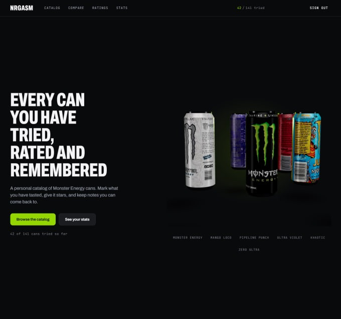
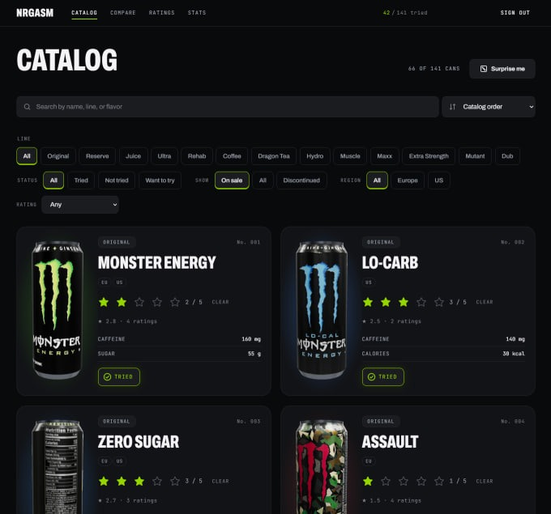
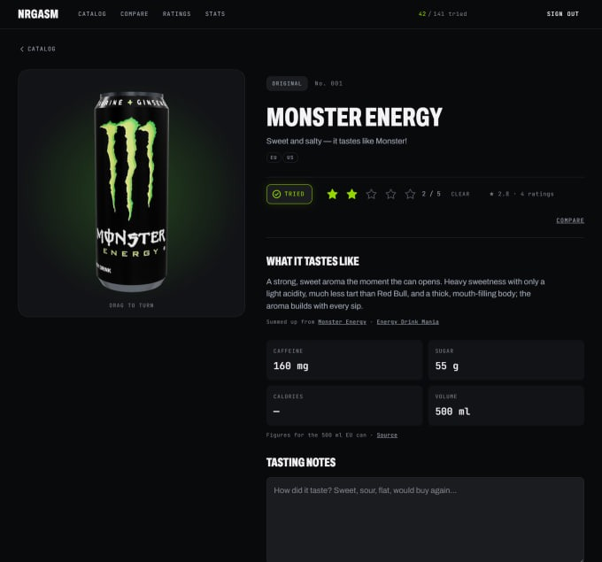
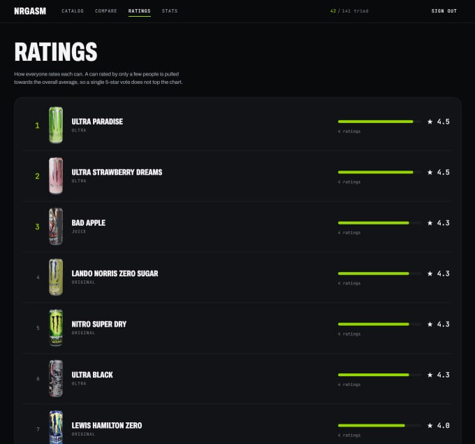
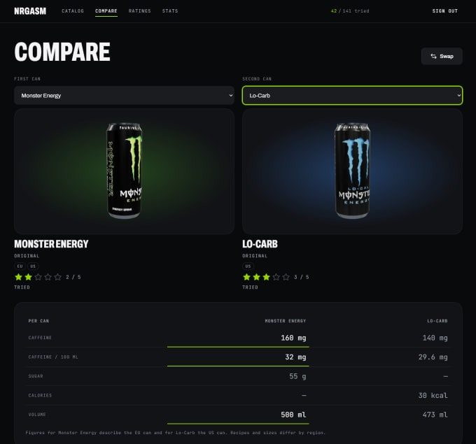
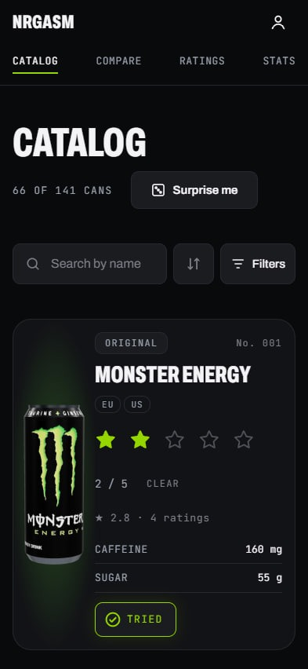
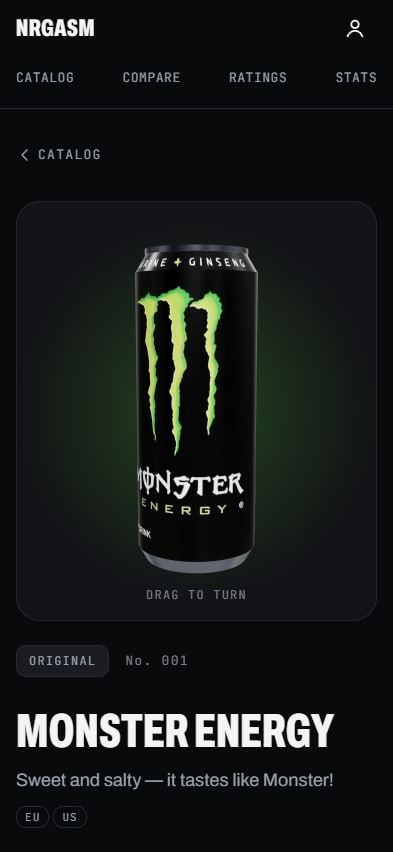

<div align="center">

# NRGASM

**Every can you have tried, rated and remembered.**

An interactive catalog of Monster Energy cans with spinning 3D cans, personal ratings and tasting notes, and community scores.

[**Live demo → nrgasm.vercel.app**](https://nrgasm.vercel.app)




</div>

## About

NRGASM is a personal tasting journal for energy drinks. Browse 141 Monster cans from Europe and the US, mark the ones you have tried, rate them from 1 to 5 stars, write notes, and see how everyone else rated them.

I built it to learn TypeScript and to practise a full product cycle: a design system, a typed data model, tested business logic, a real database with access rules, and a deploy.

## Features

- **3D cans.** A rotating ring on the home page, a spinning can on every card, and a can you can turn by drag or arrow keys on its own page.
- **Catalog of 141 cans** in 13 lines, with search, filters (line, tried, want to try, region, on sale or discontinued), and six sort orders.
- **Your tastings.** Tried, want to try, a 1–5 star rating, and notes with quick tags. Notes save on their own as you type.
- **Community ratings.** The average score and number of ratings on every can, and a ranking page of the best-rated cans.
- **Compare.** Two cans side by side: caffeine, sugar, calories, and caffeine per 100 ml, with the larger value marked.
- **Stats.** How many cans you have tried, caffeine drunk, average rating per line, and JSON export and import of your data.
- **Accounts.** Email and password sign-in. Guests can browse everything; tastings saved before signing up move into the new account.
- **Installable app.** A PWA with an icon and offline support for pages you have already opened.
- **Product facts with sources.** Every caffeine and sugar figure links to the official product page or a review. Unknown facts stay empty instead of being guessed.

## Screenshots

| Catalog | Can page |
|---|---|
|  |  |
| **Community ratings** | **Compare** |
|  |  |

<p align="center">
  
  &nbsp;&nbsp;
  
</p>

## Under the hood

- **Strict TypeScript, no `any`.** The catalog is typed as `Can[]`, and fields like ratings use literal unions (`1 | 2 | 3 | 4 | 5`) and `null` for "not rated".
- **Test-first logic.** Filtering, sorting, stats, import validation, merging, and the write queue are pure functions in `src/lib/`, covered by 126 Vitest tests. Components stay thin.
- **Row Level Security.** Each user's tastings live in one Postgres table that only its owner can read or write. Everyone's scores are read only as totals from a stats table that a database trigger keeps up to date.
- **Optimistic writes with rollback.** The UI updates at once. Writes go to Supabase in the background, one at a time per can, and a failed write rolls back to what the database holds.
- **Offline-friendly cache.** Tastings are cached per account in `localStorage`, so your data shows up at once, before the network answers.
- **Lazy 3D.** Three.js loads only where it is needed. The whole catalog shares one WebGL canvas, cans far from the screen are not drawn, and a flat label replaces the 3D can without WebGL.
- **Accessible by default.** Real buttons, links, and labels, star ratings built on native radio inputs, 44 px touch targets, 4.5:1 text contrast, and no motion under `prefers-reduced-motion`.
- **Own design system.** "Acid Lab": colors, type, spacing, and radii come only from CSS custom properties, used through CSS Modules.

## Tech stack

| Area | Tools |
|---|---|
| UI | React 19, TypeScript 6 (`strict`), React Router 8 |
| Styling | CSS Modules, CSS custom properties (design tokens) |
| 3D and motion | Three.js, React Three Fiber, drei, Motion |
| Backend | Supabase: Auth, Postgres with RLS, Storage |
| Tests and quality | Vitest, ESLint |
| Build and hosting | Vite 8, Vercel |

## Run locally

You need [Node.js](https://nodejs.org) 20.19+ or 22.12+.

```bash
git clone https://github.com/Ark4da/nrgasm.git
cd nrgasm
npm install
npm run dev       # http://localhost:5173
```

Without any setup, the app runs in guest mode: you can browse the whole catalog. For sign-in, saving, and community ratings, create `.env.local` from `.env.example` with your Supabase project's URL and publishable key. [`docs/DEPLOY.md`](docs/DEPLOY.md) walks through Supabase and Vercel step by step.

```bash
npm run build     # type-check and production build
npm run lint      # ESLint
npm run test      # Vitest
```

## Project structure

```
src/
├─ components/   one folder per component, with its CSS module
├─ pages/        route screens
├─ lib/          pure logic and its tests, no React
├─ services/     thin Supabase calls
├─ hooks/        stores for auth, user data, and ratings
├─ three/        3D scene and can model
├─ data/         the typed catalog
└─ styles/       design tokens and global styles
supabase/migrations/   database schema and access rules
```

More: [`docs/PRODUCT.md`](docs/PRODUCT.md) (scope and data model), [`docs/DESIGN.md`](docs/DESIGN.md) (the design system).

## Disclaimer

An unofficial fan project, not affiliated with or endorsed by Monster Energy. Product names belong to their owners. Can label images are not stored in this repository.

---

<div align="center">

Made by [Mykyta Kovalenko](https://github.com/Ark4da)

</div>
